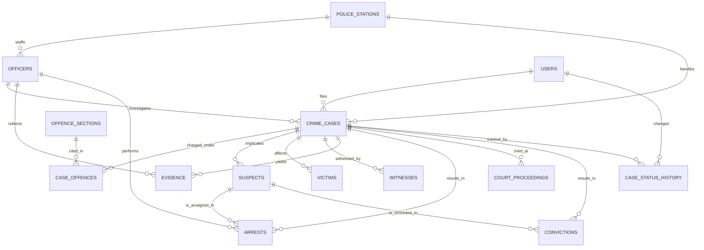

# Crime Record Management System — Design Spec

- **Date:** 2026-11-02
- **Status:** Draft for review
- **Stack:** Python 3.12 · CustomTkinter · MySQL 8.0 · mysql-connector-python · matplotlib

---

## 1. Purpose

A desktop application for a police records department to file, investigate and dispose of
crime cases, and to analyse caseload trends. It is a DBMS project: the schema, the
server-side SQL objects and the relationship integrity are the centre of the work, not
just a CRUD wrapper over a table.

### Success criteria

1. A case can be filed end-to-end from the UI, with offence sections, suspects, victims,
   witnesses and evidence attached, without touching a SQL client.
2. The database enforces every relationship — no orphan rows, no illegal case-status
   values, no deleted master leaving dangling children.
3. Case status changes are recorded automatically with who changed it and when.
4. The dashboard answers the standard viva questions: how many cases, of what type, where,
   over what period, and how many were solved.
5. The application runs on a clean machine with `pip install -r requirements.txt` and a
   MySQL 8.0 server.

### Out of scope

Biometric/fingerprint imaging, encrypted evidence vaults, inter-state data sharing,
SMS/email notification, and any web/mobile client.

---

## 2. Data model

13 tables in Third Normal Form. Every table has a surrogate `PK`, every non-key attribute
depends only on the key, and every multi-valued attribute is pulled into its own table.

### 2.1 Master tables

**`police_stations`**
| column | type | notes |
|---|---|---|
| station_id | INT PK AI | |
| name | VARCHAR(120) UNIQUE | |
| district | VARCHAR(60) | indexed |
| address | VARCHAR(255) | |
| phone | VARCHAR(20) | |
| incharge_officer_id | INT FK→officers | nullable, set after officers exist |

**`officers`**
| column | type | notes |
|---|---|---|
| officer_id | INT PK AI | |
| badge_no | VARCHAR(20) UNIQUE | |
| name | VARCHAR(120) | |
| rank | VARCHAR(40) | constable / si / inspector / dpi / sp / addl_sp |
| station_id | INT FK→police_stations | indexed |
| phone | VARCHAR(20) | |
| join_date | DATE | |
| is_active | BOOLEAN | |

**`offence_sections`**
| column | type | notes |
|---|---|---|
| section_id | INT PK AI | |
| law_code | ENUM('BNS','IPC') | Bharatiya Nyaya Sanhita / Indian Penal Code |
| section_no | VARCHAR(20) | |
| offence_name | VARCHAR(200) | |
| category | ENUM('cognizable','non_cognizable') | |
| severity | ENUM('low','medium','high','grave') | |
| min_imprisonment_yrs | DECIMAL(4,1) | |
| max_imprisonment_yrs | DECIMAL(4,1) | |
| fine_cap | DECIMAL(12,2) | nullable |
| description | TEXT | nullable |
| UNIQUE(law_code, section_no) | | |

**`users`**
| column | type | notes |
|---|---|---|
| user_id | INT PK AI | |
| username | VARCHAR(50) UNIQUE | |
| password_hash | VARCHAR(255) | PBKDF2-HMAC-SHA256, 260 000 iterations, per-user salt |
| role | ENUM('admin','officer','viewer') | |
| officer_id | INT FK→officers | nullable — links a login to a police officer |
| is_active | BOOLEAN | |
| created_at | TIMESTAMP | |

### 2.2 Case pipeline

**`crime_cases`** — the hub table.
| column | type | notes |
|---|---|---|
| case_id | INT PK AI | |
| case_no | VARCHAR(25) UNIQUE | generated by trigger as `CR/YYYY/NNNN` |
| station_id | INT FK→police_stations | indexed, RESTRICT |
| investigating_officer_id | INT FK→officers | indexed, RESTRICT |
| filed_by_user_id | INT FK→users | indexed, RESTRICT |
| category | VARCHAR(60) | theft / assault / fraud / homicide / cyber / missing_person / arson / drugs / other |
| offence_type | VARCHAR(120) | free-text classification |
| occurrence_datetime | DATETIME | |
| reporting_datetime | DATETIME | |
| place_of_occurrence | VARCHAR(255) | |
| description | TEXT | |
| status | ENUM('registered','under_investigation','charges_filed','trial','closed_convicted','closed_acquitted','closed_untraceable') | default `registered` |
| closed_datetime | DATETIME | nullable |
| summary | TEXT | |
| created_at / updated_at | TIMESTAMP | |

**`case_offences`** — resolves the M:N between a case and the sections it is charged under.
| column | type | notes |
|---|---|---|
| case_id | INT FK→crime_cases | PK part 1, CASCADE |
| section_id | INT FK→offence_sections | PK part 2, RESTRICT |
| accused_role | ENUM('primary','secondary') | |
| added_at | TIMESTAMP | |

### 2.3 Person and evidence tables

All three carry a `case_id` FK with `ON DELETE CASCADE` — a case is the aggregate root and
its children die with it.

**`suspects`** — suspect_id PK, case_id FK, name, alias, dob, gender ENUM, address,
identifying_marks, phone, status ENUM('wanted','arrested','in_custody','bailed','released','convicted','acquitted','untraceable')

**`victims`** — victim_id PK, case_id FK, name, age, gender ENUM, phone, address,
injury_level ENUM('none','minor','moderate','grievous','fatal'), statement TEXT

**`witnesses`** — witness_id PK, case_id FK, name, phone, address, statement TEXT,
is_reliable BOOLEAN

**`evidence`** — evidence_id PK, case_id FK, type ENUM('physical','documentary','digital',
'forensic','testimonial'), description, collected_by_officer_id FK→officers, collected_datetime,
seized_under VARCHAR(120), storage_location VARCHAR(120), chain_of_custody_datetime

### 2.4 Disposition tables

**`arrests`** — arrest_id PK, case_id FK, suspect_id FK, arrested_by_officer_id FK→officers,
arrest_datetime, place_of_arrest, remand_status ENUM('not_remanded','police_remand','judicial_remand','bail'),
bail_amount DECIMAL(12,2) nullable

**`court_proceedings`** — proceeding_id PK, case_id FK, court_name, hearing_datetime,
stage ENUM('first_hearing','charge_frame','evidence','arguments','verdict'), judge_name,
next_hearing_datetime, remarks

**`convictions`** — conviction_id PK, case_id FK, suspect_id FK, court_name, verdict
ENUM('guilty','acquitted','case_dismissed'), sentence_type ENUM('fine','imprisonment','community_service','life_imprisonment','none'),
imprisonment_years DECIMAL(4,1) nullable, fine_amount DECIMAL(12,2) nullable,
sentence_start DATE, release_expected DATE

**`case_status_history`** — history_id PK, case_id FK CASCADE, old_status VARCHAR(30) nullable,
new_status VARCHAR(30), changed_by_user_id FK→users, remark VARCHAR(255), changed_at TIMESTAMP.
**Written only by triggers** — the application never inserts into this table directly.

### 2.5 ER diagram



### 2.6 Integrity rules

- Every FK is declared explicitly with a delete rule. `RESTRICT` on masters (stations,
  officers, users, offence sections) so a station cannot be deleted while it holds cases;
  `CASCADE` on case children so deleting a case removes its suspects, evidence and history.
- `CHECK` constraints carry the rules a column type cannot: `min_imprisonment_yrs <=
  max_imprisonment_yrs`, `occurrence_datetime <= reporting_datetime`, `closed_datetime`
  present exactly when the case is closed, victim age between 0 and 120, and
  `bail_amount` / `fine_amount` not negative.
- Indexes on every column used for filtering or joining: `crime_cases(status)`,
  `crime_cases(station_id)`, `crime_cases(investigating_officer_id)`,
  `crime_cases(occurrence_datetime)`, `suspects(case_id)`, `evidence(case_id)`, plus
  prefix indexes on `case_no`, `badge_no`, `username`.

---

## 3. Server-side SQL objects

The application calls stored procedures for business operations and plain SELECTs for
simple reads. Nothing in Python duplicates a rule that belongs in the database.

### 3.1 Views

| view | purpose |
|---|---|
| `v_case_overview` | one row per case: case_no, offence summary, station, investigator, suspect/victim/evidence counts, current status, age in days. The main list and detail screens read from this. |
| `v_officer_workload` | per officer: open cases, closed cases, avg days to close, per status |
| `v_station_statistics` | per station: total cases, convictions, acquittals, untraceable, clearance rate |
| `v_offence_statistics` | per offence section: case count, distinct cases, severity |
| `v_monthly_caseload` | cases registered and closed per month for the last 24 months |
| `v_suspect_summary` | per suspect: case count, current status, total sentence years |
| `v_upcoming_hearings` | next hearing per case with days remaining, for the dashboard and Court screen |

### 3.2 Stored procedures

| procedure | does |
|---|---|
| `sp_file_case` | inserts a case (trigger assigns `case_no`), links the offence sections, assigns the station/officer, records the initial status history, returns `case_id`. Called in one round trip from the File Case form. |
| `sp_update_case_status` | validates the status transition against the legal path, updates `crime_cases.status` and `closed_datetime`, and lets the trigger write history. Raises `SIGNAL SQLSTATE '45000'` on an illegal transition. |
| `sp_assign_officer` | reassigns the investigating officer, rejecting officers not posted at the case's station. |
| `sp_search_cases` | multi-criteria search: case_no, date range, station, officer, status, offence section, category, free text. Returns `v_case_overview` rows. |
| `sp_record_arrest` | inserts the arrest and updates the suspect's status to `arrested`. |
| `sp_record_conviction` | inserts the conviction, updates suspect status, and advances the case to its closed status. |
| `sp_dashboard_summary` | returns the headline counters: total, open, closed, convicted, acquitted, untraceable, clearance rate, avg disposal days, and counts for the last 30 days. |

### 3.3 Triggers

| trigger | fires on | effect |
|---|---|---|
| `trg_cases_before_insert` | BEFORE INSERT on `crime_cases` | assigns `case_no` = `CR/<year>/<4-digit sequence>` using a counter table so two concurrent filings cannot collide |
| `trg_cases_after_status_update` | AFTER UPDATE on `crime_cases` when `status` changes | writes a `case_status_history` row |
| `trg_cases_after_insert` | AFTER INSERT on `crime_cases` | writes the initial `registered` history row |
| `trg_suspects_after_arrest` | AFTER INSERT on `arrests` | sets the suspect status to `arrested` |
| `trg_suspects_after_conviction` | AFTER INSERT on `convictions` | sets the suspect status to `convicted` / `acquitted` |
| `trg_case_offences_after_insert` | AFTER INSERT on `case_offences` | maintains `crime_cases.offence_count` |
| `trg_case_offences_after_delete` | AFTER DELETE on `case_offences` | decrements `crime_cases.offence_count` |
| `trg_evidence_after_insert` | AFTER INSERT on `evidence` | stamps `chain_of_custody_datetime` when the evidence row is created without one |

### 3.4 Case status workflow

```
registered ──▶ under_investigation ──▶ charges_filed ──▶ trial ──┬─▶ closed_convicted
     │                │                      │                   └─▶ closed_acquitted
     └────────────────┴──────────────────────┴──────────────────────▶ closed_untraceable
```

The rule the database enforces is **forward-only by rank**, not a fixed edge list. Each
status carries a rank — `registered` 1, `under_investigation` 2, `charges_filed` 3,
`trial` 4, every `closed_*` 5. `sp_update_case_status` rejects a move whose target rank
is not greater than the current rank, and rejects any change to a case that is already
closed. In practice that means a case may skip a stage (a property case can go straight
from `registered` to `closed_untraceable`) but can never run backwards, and a closed case
cannot be reopened.

Both rejections are `SIGNAL SQLSTATE '45000'` with a message the UI surfaces verbatim:
*"A case cannot move backwards in the investigation lifecycle"* and *"Case is already
closed and cannot be reopened"*.

A `CHECK` constraint keeps `crime_cases.closed_datetime` consistent with `status`: the
column is `NOT NULL` exactly when the status is one of the three closed states, and
`NULL` otherwise.

---

## 4. Application architecture

### 4.1 Layers

```
UI layer      app/ui/views/*        widgets, no SQL
              app/ui/widgets.py     reusable components
              app/ui/theme.py       palette, fonts, spacing
                    │  calls repository methods
Data layer    app/db/*.py           one repository per aggregate
              app/db/connection.py  config load, pooled connections, query helpers
                    │  SQL / CALL
Database      MySQL 8.0             tables, views, procedures, triggers
```

- The UI never imports `mysql.connector`. It never sees a cursor or a row tuple.
- A repository method returns plain dicts (or a list of dicts) — `cursor(dictionary=True)`.
- Every query is parameterised (`%s` placeholders). No string interpolation of user input
  into SQL, ever.
- `connection.py` owns a single connection guarded by a re-entrant lock. If the server
  drops it, the next query reconnects transparently, so a long-running desktop session
  survives a MySQL restart.

### 4.2 File layout

```
CrimeRecordManagementSystem/
├── main.py                     entry point: login screen → app shell
├── config.ini                  local credentials (git-ignored)
├── config.ini.template
├── requirements.txt
├── README.md
├── sql/
│   ├── schema.sql              tables, constraints, indexes
│   ├── views.sql
│   ├── procedures.sql
│   ├── triggers.sql
│   └── reference_data.sql      stations, offence sections
├── scripts/
│   ├── setup_db.py             applies all sql/ files, idempotent
│   └── selftest.py             schema + procedure + role assertions
├── app/
│   ├── db/
│   │   ├── connection.py       config load, connection, error translation
│   │   ├── auth.py             users, login, role checks, Repository base
│   │   ├── passwords.py        PBKDF2 hashing
│   │   ├── masters.py          stations, officers, offence sections
│   │   ├── cases.py            case filing, search, status workflow
│   │   ├── persons.py          suspects, victims, witnesses
│   │   ├── evidence.py
│   │   ├── legal.py            arrests, proceedings, convictions
│   │   ├── reports.py          dashboard aggregations
│   │   └── repositories.py     one place to reach every repository
│   ├── ui/
│   │   ├── theme.py            palette, fonts, spacing
│   │   ├── widgets.py          Card, StatCard, DataTable, FormPanel, toast
│   │   ├── charts.py           matplotlib helpers
│   │   ├── dialogs.py          FormDialog, ChoiceDialog
│   │   ├── login.py
│   │   ├── app_window.py       sidebar, header, role-filtered navigation
│   │   └── views/
│   │       ├── base.py         shared screen behaviour
│   │       ├── dashboard.py
│   │       ├── cases.py        case list, filing form, case detail
│   │       ├── persons.py      suspects, victims, witnesses
│   │       ├── evidence.py
│   │       ├── court.py        proceedings and convictions
│   │       ├── masters.py      stations, officers, offence sections
│   │       └── users.py
└── docs/
    └── superpowers/specs/
```

### 4.3 Data flow — filing a case

1. User fills the File Case form (case fields plus a checkbox per offence section).
2. `CaseRepository.file_case()` calls `CALL sp_file_case(...)` with the parameters.
3. MySQL assigns `case_no`, inserts the case, inserts `case_offences` rows, and the
   triggers write the first status-history entry.
4. The procedure returns `case_id`; the UI opens the new case's detail screen and shows
   a toast with the assigned case number.

---

## 5. User interface

### 5.1 Look and feel

CustomTkinter with a dark default theme and a light theme toggle. Palette: deep slate
background (`#11151c`), raised card surface (`#1b212b`), accent teal (`#3fb6a8`) for
primary actions, amber (`#e8a33d`) for warnings, rose (`#e05263`) for destructive actions
and critical severity, soft green (`#4caf7d`) for cleared/closed states. Rounded 12px
cards, one accent colour per severity, no borders on cards — separation by surface
elevation only.

Typography: Segoe UI. 24px semibold for page titles, 15px for section headers, 13px for
body and table content, 11px uppercase for field labels.

### 5.2 Shell

A left sidebar (236px) lists the modules; the content area holds the active screen.
The header shows the current module name and subtitle, a theme toggle and a Refresh
button. The sidebar footer shows the signed-in user, their role, and a Sign out button.
Sidebar items are filtered by role, so an officer never sees the Administration group
and a viewer sees no write controls at all.

### 5.3 Screens

| screen | roles | contents |
|---|---|---|
| Login | — | username/password, error state, hint of the default admin |
| Dashboard | all | 5 KPI cards, 4 charts, recent cases table, upcoming hearings |
| Cases | all (viewer read-only) | searchable/filterable list, status filter chips, New Case button, row click → detail |
| Case Detail | all | tabbed: Overview, Offences, Suspects, Victims, Witnesses, Evidence, Custody, Court, Conviction, History — each data tab carries an Add button for writers |
| Suspects / Victims / Witnesses | all | master list per person type, linked back to case |
| Evidence | all | evidence register with type and chain-of-custody filter |
| Court | all | proceedings schedule + convictions list |
| Stations | admin | CRUD for stations |
| Officers | admin | CRUD for officers, workload column |
| Offence Sections | admin | CRUD for the law library |
| Users | admin | CRUD for logins, role assignment, password reset |

Every list screen is a reusable `DataTable` component: sortable headers, a search box, a
row-count label, double-click to open the linked case, and an empty state.

Every editable screen is a `FormPanel`: field grid with labels above inputs, required
markers, inline validation, and a Save / Cancel footer.

### 5.4 Role behaviour

| capability | admin | officer | viewer |
|---|---|---|---|
| View dashboard, lists, case detail | yes | yes | yes |
| File / edit cases | yes | yes | no |
| Add suspects, victims, witnesses, evidence | yes | yes | no |
| Record arrests, court proceedings, convictions | yes | yes | no |
| Manage stations, officers, offence sections | yes | no | no |
| Manage users, reset passwords | yes | no | no |
| Delete operational records (persons, evidence, custody, court) | yes | yes | no |
| Delete a case | yes | no | no |

Enforcement is two-layered: the UI hides or disables controls the role cannot use, and
the repository layer re-checks the role before writing. The second layer is the one that
actually protects the data.

The repository layer works through a single `Repository` base class in `app/db/auth.py`.
Every repository extends it and declares the roles allowed to write:

| repository | write roles |
|---|---|
| `UserRepository`, `StationRepository`, `OfficerRepository`, `OffenceRepository` | admin only |
| `CaseRepository`, `SuspectRepository`, `VictimRepository`, `WitnessRepository`, `EvidenceRepository`, `ArrestRepository`, `ProceedingRepository`, `ConvictionRepository` | admin, officer |

Reads never check the role. Writes go through `Repository.execute` / `Repository.call`,
which call `require_role` and raise `AccessDenied` before the statement is sent to
MySQL. `CaseRepository.delete` additionally requires admin, because deleting a case
removes its whole evidence trail.

`Repositories` is constructed with the signed-in user, so every screen gets a
repository bound to the actor: `Repositories(db, user)`.

---

## 6. Error handling and security

- **DB errors:** every repository call is wrapped; `IntegrityError` is translated into a
  message that names the constraint ("That police station cannot be deleted while cases
  still reference it.") instead of a MySQL error string. `SIGNAL SQLSTATE '45000'`
  messages from procedures are passed through unchanged, because they are already written
  for the user. Unexpected errors are logged to `logs/app.log` and shown as a toast.
- **Connection loss:** the connection layer detects a dropped connection and
  re-establishes it on the next query. If the server is unreachable at startup, the app
  shows a "Cannot reach MySQL" card with Retry and Quit rather than a stack trace.
- **Validation:** UI-level validation for required fields, formats and ranges, with the
  database `CHECK`/FK constraints as the backstop.
- **Passwords:** PBKDF2-HMAC-SHA256 with a per-user random salt, 260 000 iterations,
  constant-time comparison. No plaintext password is ever stored or logged.
- **Credentials:** `config.ini` is git-ignored; `config.ini.template` holds placeholders
  only.
- **SQL injection:** all queries parameterised.

---

## 7. Testing and demo

- `scripts/selftest.py` asserts the schema is correct and the stored procedures behave:
  filing a case assigns a sequential case number, an illegal status transition raises an
  error, a conviction flips the suspect and case status, and a delete is blocked by FK
  restrict. It also asserts the role layer: a viewer cannot write, and an officer cannot
  edit master data. Runs against the database named in `config.ini`.
- `python -m compileall app main.py scripts` and an import sweep over every module are
  the smoke test that runs without a database.
- Manual smoke path documented in the README: login → file a case → add offences,
  suspects, evidence → advance the status → record a court proceeding and conviction →
  watch the dashboard update.
- Every screen is demoable with live data entered during the demo.

---

## 8. Build phases

Each phase ends with something runnable.

1. **Foundation** — config, connection layer, `schema.sql`, `setup_db.py`, theme, login,
   app shell with working sidebar navigation.
2. **Masters** — stations, officers, offence sections, users screens with role gating.
3. **Cases** — case list with search, file-case form, case detail with Overview and
   Offences tabs, status workflow.
4. **Persons & evidence** — suspects, victims, witnesses, evidence tabs and screens.
5. **Custody & court** — arrests, proceedings, convictions, timeline.
6. **Dashboard & polish** — charts, KPI cards, reports, empty states, error banners.

---

## 9. Reference data and open items

- **Law library.** The `offence_sections.law_code` column is `ENUM('BNS','IPC')` so both
  codes are supported. The seed ships **33 IPC sections** — the Bharatiya Nyaya Sanhita
  numbering was still settling in the sources available at build time, and seeding a
  section number that turns out to be wrong would be worse than seeding the code that is
  verifiable. BNS rows are added from the Offence Sections screen like any other entry.
- **Stations and officers.** The seed ships 8 stations and one officer per station, so the
  officer pickers in the File Case and Evidence forms have something to offer from the
  first run. Station names and districts are meant to be edited to match the local police
  jurisdiction before a demo.
- **Case numbering.** A dedicated `case_sequences` counter table is used rather than a
  `SELECT MAX()` lookup, so two concurrent filings cannot collide on the same number.
- **The default admin** (`admin` / `admin123`) is created by `scripts/setup_db.py` only
  if no admin account exists. Change the password from the Users screen before any demo.
